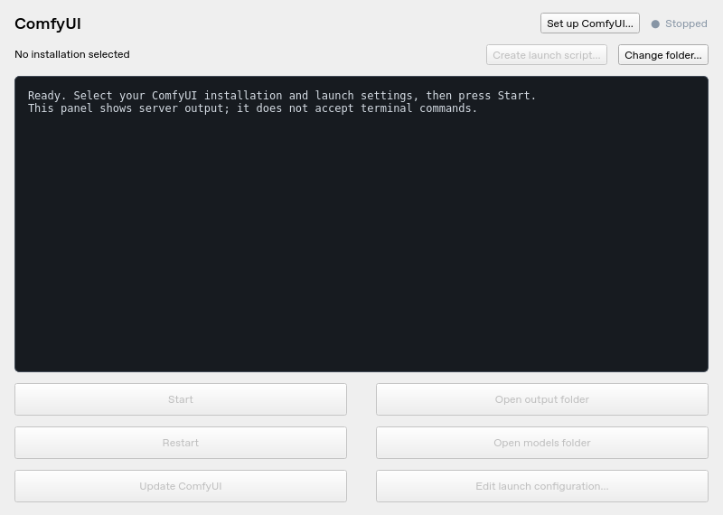
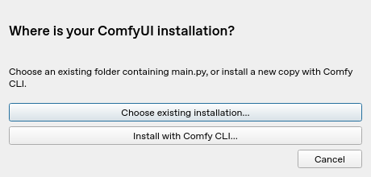
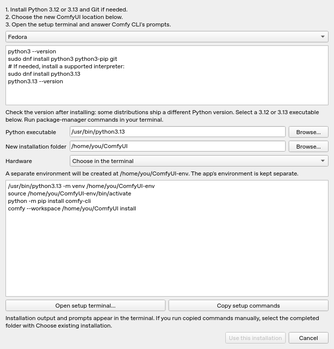
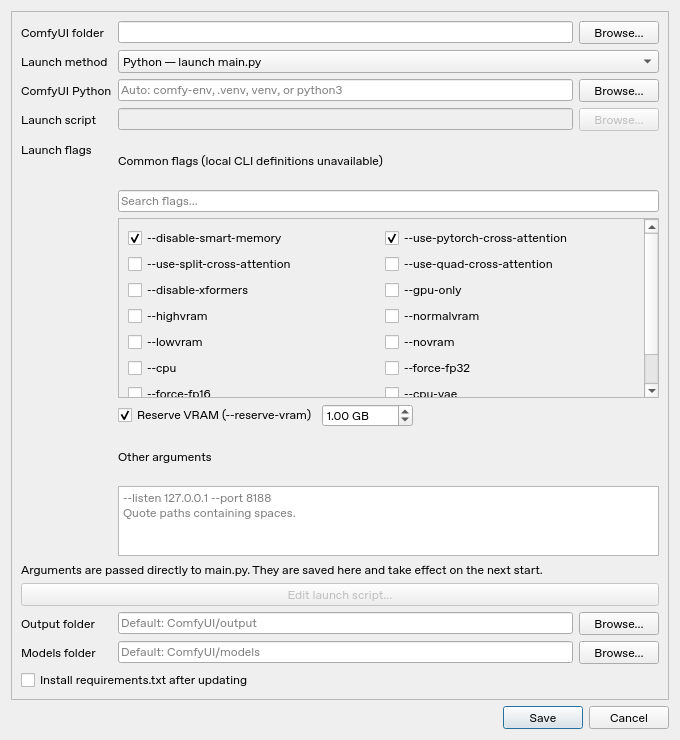
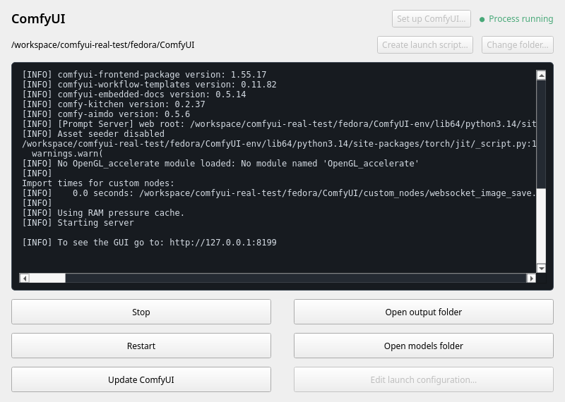

# ComfyUI Control

A small native Qt 6 window for Fedora Linux and KDE Plasma, matching the supplied sketch. Live server output sits above Start/Stop, Restart, Update, Open output folder, Open models folder, and Edit launch configuration buttons. A visible **Change folder…** button lets you switch installations later.



The preview uses sample server output. Qt's appearance follows the available desktop theme and platform integration.

## Install on Fedora

Fedora RPM build instructions and a prepared COPR source-build recipe are in
[packaging/README.md](packaging/README.md). A public COPR repository has not yet
been created.

This application controls an existing ComfyUI installation or guides you through installing a new one with Comfy CLI. GPU drivers and models are configured separately.

Extract the archive, open a terminal in the `comfyui-control` folder, then run:

```bash
sudo dnf install python3 python3-pip git
bash install.sh
```

The installer downloads Qt's Python bindings and installs the application for your user, without sudo. Open **ComfyUI Control** from the KDE application menu, or run `~/.local/bin/comfyui-control`. GUI dependencies live in their own virtual environment; ComfyUI keeps its existing environment.

For development or running directly from the source:

```bash
python3 -m venv .venv
.venv/bin/python -m pip install .
.venv/bin/python -m comfyui_control
```

## First launch and configuration

When no installation is configured, startup asks you to **Choose existing installation…** or **Install with Comfy CLI…**. Existing users choose their own folder containing `main.py`; there is no preset installation path. A saved, available installation opens directly on later launches. If its folder has moved or is unavailable, setup is shown again. **Set up ComfyUI…** reopens both choices, and **Change folder…** selects another existing installation.



- **Python:** starts `main.py` using the specified Python executable. Leave Python blank to detect `comfy-env/bin/python`, then `.venv/bin/python`, then `venv/bin/python`, then a companion `<installation-name>-env/bin/python` next to the installation, then `python3`. For Conda or an environment elsewhere, browse to its actual `bin/python` executable. Put flags such as `--listen 127.0.0.1 --port 8188` in Launch arguments.
- **Existing Bash launch script:** select your `.sh` file. It runs with `/bin/bash` and the ComfyUI folder as its working directory. **Edit launch script…** opens it in KWrite or Kate so you can change flags already hardcoded there. Additional Launch arguments are appended to the script; your script must forward them with `"$@"` to use them. This output viewer supports scripts that run without interactive prompts.

For a script you can adapt, the last lines should look like:

```bash
cd "/path/to/your/ComfyUI" || exit 1
exec .venv/bin/python -u main.py --listen 127.0.0.1 --port 8188 "$@"
```

Keep your existing environment activation and flags if you already have them. `exec` helps the controller track the server; avoid backgrounding or daemonizing it. Stopping also signals child processes in the controller's process group.

### Install a new ComfyUI with Comfy CLI

The startup installer reuses your **installed Python 3**, including Python 3.14. It preselects `python3` from your PATH. Check the version if needed:

```bash
python3 --version
```

Run the following package commands only if prerequisites are missing. Existing, working installations can be selected directly in the startup dialog.

Fedora:

```bash
sudo dnf install python3 python3-pip git
```

Ubuntu/Debian:

```bash
sudo apt update
sudo apt install python3 python3-pip python3-venv git -y
```

Arch Linux:

```bash
sudo pacman -S python python-pip git
```

You can select another installed Python executable if needed for your environment. Package-manager commands are shown for missing prerequisites; the app does not run sudo itself. Comfy CLI and package installers report their own dependency requirements in the terminal.

Choose a **new installation folder**, select the Python executable, and optionally choose NVIDIA, AMD/ROCm, or CPU. **Open setup terminal…** opens Konsole (or another available terminal) and runs a visible setup script. Comfy CLI can ask questions there, including hardware selection when none was selected in the dialog.

The script checks Python's version, creates a companion virtual environment next to the chosen folder, activates it, and runs:

```bash
python -m pip install comfy-cli
comfy --workspace "/path/to/your/ComfyUI" install
```

This is the `pip install comfy-cli` → `comfy install` workflow with an explicit destination and an isolated Python environment. The environment is outside the ComfyUI checkout, so it does not block Git updates. Existing installation or environment folders are refused; use the existing-installation option for those. The app's own GUI environment is kept separate.

After setup succeeds and `main.py` is present, **Use this installation** saves both the chosen location and its Python executable. Choosing CPU in the app also preselects `--cpu` in the launch flags; select that checkbox yourself if you chose CPU interactively in the terminal. No installation is selected on failure. Check the terminal output to resolve failures; an incomplete installation may require Comfy CLI's restore workflow or a fresh location. Canceling the app dialog does not stop the detached setup terminal; stop that terminal if you want to cancel installation too.

**Copy setup commands** lets you run the same installation steps manually. After completing copied commands, select the folder with **Choose existing installation…**. The app's generated terminal script and result marker remain under its configuration folder for troubleshooting. Comfy CLI's upstream instructions are available in its [README](https://github.com/Comfy-Org/comfy-cli#installation).



### Select launch flags

**Edit launch configuration…** includes searchable checkboxes for the boolean flags supported by your installed ComfyUI version. It reads `comfy/cli_args.py` as text without running or importing ComfyUI. Each flag's tooltip shows its help text. If that file is unavailable or cannot be read, a labeled list of common flags is used instead.

Choose options such as `--disable-smart-memory`, `--use-pytorch-cross-attention`, `--lowvram`, and `--cpu-vae` with checkboxes. Mutually exclusive options automatically uncheck one another. **Reserve VRAM** enables a numeric GB field. **Other arguments** accepts options requiring other values, such as `--port 8188`, plus flags not listed as checkboxes. Selections are saved between sessions.



### Create a launch script

The small **Create launch script…** button beside the installation path first opens the checkbox selector, then saves an executable `.sh` file and selects it as the launch method. Existing configured flags are preselected; when none are configured, the HIP preset is suggested. The generated script uses the selected Python executable, activates its virtual environment when an adjacent activation script is available, changes into the selected ComfyUI folder, sets `PYTORCH_HIP_ALLOC_CONF=expandable_segments:True`, then launches with the selected flags. For an installation with a `comfy-env` folder, the initial preset is equivalent to:

```bash
exec ./comfy-env/bin/python main.py \
  --use-pytorch-cross-attention \
  --disable-smart-memory \
  --reserve-vram 1 \
  "$@"
```

The Python environment must already exist; this button creates the launch script, not the environment. It also works with environments created by the Comfy CLI setup flow, `.venv`, or an explicitly selected interpreter. If no interpreter or local environment was found, the script targets `comfy-env/bin/python` inside the selected folder. Folder paths containing spaces or shell characters are quoted safely. `exec` keeps Start/Stop and Restart in control of the Python server. Additional arguments can be added in the configuration dialog.

By default the script is saved next to the application's settings, outside the ComfyUI checkout, so it does not introduce an untracked file that blocks Update. You can choose another location and filename. Existing scripts are not overwritten. Creating a script preserves your chosen additional arguments and selects the same Python executable for optional dependency updates.

Scripts created by this version store your chosen defaults for standalone use. When started from the app, they receive the current checkbox selections instead, so unchecking a flag removes it even when it appeared in the original defaults. This also works when every flag is unchecked. The app uses a private argument marker that the generated script removes before launching ComfyUI. To change the environment activation or HIP setting, use **Edit launch configuration… → Edit launch script…**.

Existing custom scripts and scripts generated by versions before 0.3 continue to receive appended arguments; flags hardcoded inside them must be edited in the script or replaced by creating a new script with this version.

The settings are stored in `~/.config/comfyui-control/config.json` (or `$XDG_CONFIG_HOME/comfyui-control/config.json`). Settings can be edited while stopped. Changing installation folders resets the interpreter, script, arguments, and custom folder paths, so configure the new installation before starting it.

Output and models buttons use the installation's `output` and `models` subfolders. If your flags or scripts relocate these folders, set the corresponding custom paths in the configuration dialog too. These custom paths control the folder buttons; they do not change ComfyUI's flags.

## Server output and lifecycle

The output pane is a read-only log, not an interactive shell. It merges stdout and stderr, handles streamed UTF-8 and common ANSI escapes, and retains the last 5,000 lines. Scroll up to pause following new output. “Process running” indicates the process is alive; check ComfyUI's output for the URL and whether startup has completed.

Stop sends SIGTERM to the process group, then SIGKILL after eight seconds if necessary. Restart waits for shutdown before launching again. Closing an active window asks to stop its process before exiting. Only one controller window per user is allowed. The app manages processes it launched; stop any separately running ComfyUI before using it.

## Updates

Update requires the selected folder to be the root of a Git checkout. It checks for tracked modifications and untracked files, then runs `git pull --ff-only` against the branch's configured upstream. It never resets, cleans, or stashes your changes. Git divergence, local changes, authentication failures, or command errors stop the update and remain visible in the output. If Git reports untracked models/output files, check the installation's `.gitignore` or move them before updating.

If ComfyUI is running, Update stops it and restarts it only after a successful update. On failure it stays stopped. Optional **Install requirements.txt after updating** runs `python -m pip install -r requirements.txt` with the selected ComfyUI interpreter. It is off by default because it can change GPU and other dependencies. In script mode, explicitly select the Python executable used by your script before enabling this option. Updates cover the core checkout and optionally its requirements; custom nodes have their own update procedures. There is no automatic rollback if Git succeeds but dependency installation fails.

## Troubleshooting

- **ComfyUI exits immediately:** check the log and the interpreter/launch script; confirm your normal launch command works in a terminal.
- **Qt reports an xcb plugin error:** on minimal Fedora installations run `sudo dnf install libxcb xcb-util-cursor xcb-util-wm xcb-util-keysyms libxkbcommon-x11`. KDE Wayland can also be selected with `QT_QPA_PLATFORM=wayland ~/.local/bin/comfyui-control`.
- **Comfy CLI cannot write its configuration:** Comfy CLI 1.22.0 uses `~/.config/comfy-cli` even when `XDG_CONFIG_HOME` is set. Run it with a writable user home directory. A read-only home blocked the initial sandbox test; a Fedora container with a normal writable home completed setup successfully.
- **No script editor:** install `kwrite` or `kate`, or edit the script in your preferred editor.
- **Folder unavailable:** check that the drive is mounted and choose the correct installation folder.

## Tests

```bash
.venv/bin/python -m pip install pytest
QT_QPA_PLATFORM=offscreen .venv/bin/python -m pytest
```

Tests use temporary fake servers and local Git repositories. They do not touch your ComfyUI installation or require a GPU.

### Real installation verification

On 2026-10-14, a fresh GitHub checkout of version 0.4.1 (commit `41b262d`) was downloaded and installed in an isolated Fedora 44 container. The actual Qt app ran on an X11 virtual display with Python **3.14.8** and PySide6 **6.12.0**. Its startup and setup buttons launched a real terminal, installed **Comfy CLI 1.22.0**, and used `comfy install --cpu` to install **ComfyUI 0.40.0** with **PyTorch 2.14.1+cpu** and frontend **1.55.17**. The installation was selected through the app after its success marker appeared.

The app's Start button launched ComfyUI with `--cpu --listen 127.0.0.1 --port 8199`. Both `/` and `/system_stats` returned HTTP 200. Restart produced a new server process and both endpoints responded again. Stop shut down the process and closed the port. Real server output appeared in the app's output pane throughout. This validation covers CPU installation and server control; GPU/ROCm, KDE Plasma integration, and model inference were not exercised.



## Uninstall

Remove `~/.local/share/comfyui-control`, `~/.local/share/applications/comfyui-control.desktop`, and `~/.local/bin/comfyui-control` (use your configured XDG data folder if different). Settings under `~/.config/comfyui-control` can be kept for reinstalling or removed separately. Your ComfyUI installation is unchanged.
