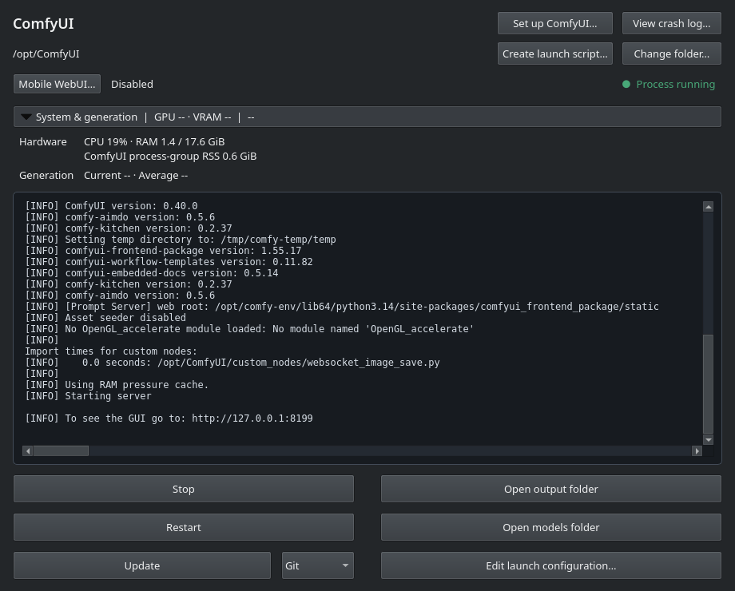
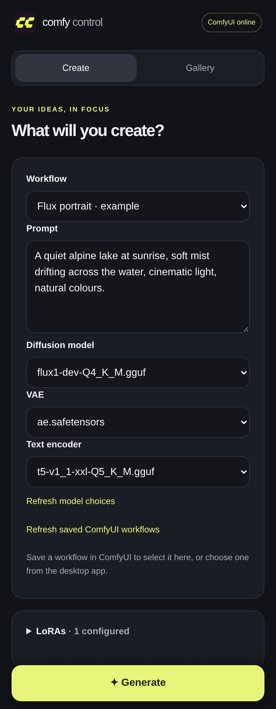
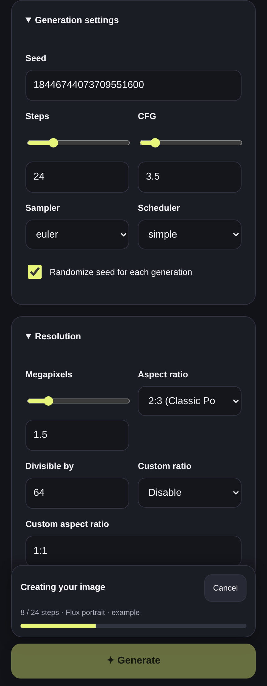

# ComfyUI Control

A small Qt app for ComfyUI on Linux, built with KDE Plasma in mind.
Start/stop, restart, Git or Comfy CLI updates, launch flags, and folder shortcuts.
Includes a [Mobile WebUI](docs/MOBILE.md) for generating images from your phone.

**1.0.0rc1:** tray controls, expandable mobile prompts, and optional
[NFS output with local fallback](docs/NFS_OUTPUT.md). [Release notes](docs/releases/1.0.0rc1.md).

[System/sampling monitoring and optional crash recovery](docs/FEATURES.md) keep
server activity visible without leaving the app.



*Fedora RPM, Qt Fusion dark theme, running a CPU ComfyUI server. Appearance follows your Qt/desktop theme.*

## Install

**Fedora 44 · x86_64**

```bash
sudo dnf copr enable jhakuzi/comfyui-control
sudo dnf install comfyui-control
```

**ZIP install · Fedora, Debian/Ubuntu, Arch**

[Download the app ZIP](https://github.com/jhakuzi/comfyui-control/raw/refs/heads/main/downloads/comfyui-control.zip), extract it, and open a terminal in the extracted folder.

| Distribution | Prerequisites |
| --- | --- |
| Fedora | `sudo dnf install python3 python3-pip git` |
| Debian / Ubuntu | `sudo apt update && sudo apt install python3 python3-pip python3-venv git` |
| Arch | `sudo pacman -S --needed python python-pip git` |

Then install as your normal user, **without sudo**:

```bash
bash install.sh
```

## Use

Open **ComfyUI Control** from the application menu. Select your existing ComfyUI
folder containing `main.py`, or choose **Install with Comfy CLI**, then press **Start**.
Use **Settings** for Python, scripts, flags, and the application style.

## Mobile UI

Generate from your phone over your LAN or VPN using saved ComfyUI workflows.

<a href="docs/screenshots/mobile-create-0.10.1.png"></a>
<a href="docs/screenshots/mobile-generation-0.10.1.png"></a>

*Current Mobile WebUI with an example workflow and simulated sampling progress. Click to enlarge.*

- Edit prompts, choose models (including GGUF), and adjust supported LoRAs and generation settings.
- Follow live progress and previews above Generate while scrolling. Jobs and drafts recover after reconnecting.
- Browse your gallery, save images, and reuse settings or create variations.
- Select two gallery images to compare them with a touch slider.

Live s/it, VRAM and GPU usage, searchable prompt history/favorites, and image
Details keep generation controls close at hand. Comparison keeps the selected
pair in your phone tab's memory after downloading both images.

Open **Mobile WebUI** in the desktop app, enable it, choose a default workflow,
click **Apply**, and scan the QR code. Keep the desktop app and ComfyUI running.
Password protection is optional.

[Setup, workflow compatibility & troubleshooting](docs/MOBILE.md)

## Update

- **RPM:** `sudo dnf upgrade --refresh comfyui-control`
- **ZIP:** close the app, extract the latest ZIP, and rerun `bash install.sh`.

The app's **Update** button updates your ComfyUI installation. Settings are kept
when updating this app.

[Usage & troubleshooting](https://github.com/jhakuzi/comfyui-control/blob/main/docs/USAGE.md) · [Maintainer guide](https://github.com/jhakuzi/comfyui-control/blob/main/docs/MAINTAINING.md) · [MIT license](LICENSE)
