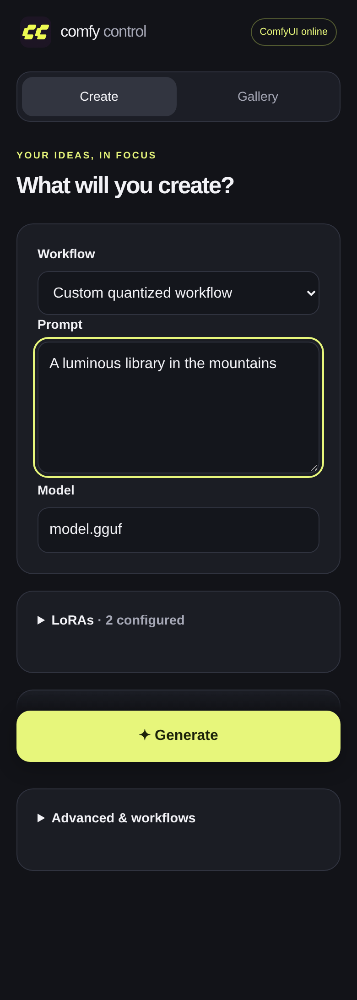

# Mobile WebUI

Available in **ComfyUI Control 0.9.0**. No separate service or mobile installation
is required. Keep the desktop app open while using it.

## Run from source in an isolated environment

Close any running ComfyUI Control window, then:

```bash
git clone --single-branch --branch main https://github.com/jhakuzi/comfyui-control.git comfyui-control-mobile
cd comfyui-control-mobile
python3 -m venv .venv-test
.venv-test/bin/python -m pip install .
.venv-test/bin/comfyui-control
```

Use the usual distribution prerequisites in the [README](../README.md).
This test environment does not replace your RPM or desktop launcher. It reads
your existing launch settings; mobile preferences are stored separately.
Only one copy of the app can run at a time for the same user.

Alternatively, [download the app ZIP](https://github.com/jhakuzi/comfyui-control/raw/refs/heads/main/downloads/comfyui-control.zip)
and use `bash install.sh` for the usual per-user installation. That changes the
per-user launcher; use the isolated environment above if you want an easy
return to your stable RPM.

## Connect your iPhone



*Chromium capture at iPhone width using a protocol-test preset; model inference is not shown.*

1. Open **Mobile WebUI…** in the desktop window.
2. Enable the feature. It listens on `0.0.0.0` for IPv4 LAN/VPN access and
   automatically advertises the detected local address in the URL and QR code.
   **Use LAN / VPN** restores this automatic setup. You can still enter a
   particular interface IP, IPv6 address, or `127.0.0.1` for local-only access.
3. Choose a port (default **8189**). Password protection is **optional** and off
   by default. Check **Use a password** if wanted, then enter at least 10 characters.
4. Leave **Phone hostname / URL** blank for detection, or enter your VPN IP or
   hostname. This is independent of the listening interface. Use an explicit
   address when automatic detection chooses the wrong interface.
5. Check **ComfyUI API URL**. It defaults to `http://127.0.0.1:8188`; change it
   if your launch flags use another port. ComfyUI itself can remain loopback-only.
6. Click **Apply**, wait for **Listening**, and scan the QR with the iPhone camera.
   Sign in only if you enabled a password. The QR contains only the URL.

**Open in browser** and **Copy URL** use the same address. The QR updates when
the advertised address or port changes; apply changes before connecting.
A full HTTP(S) origin can override the advertised URL for a reverse proxy,
for example `https://comfy.your-vpn-domain.example`. Its external port is
independent of the internal listener port. Path-prefix proxying is not supported.

If you use Fedora's firewall, allow the selected port in the appropriate LAN
or VPN zone yourself. Do not open a public router port. The app makes no firewall,
router, UPnP, or VPN configuration changes. Your phone must be able to route to
the advertised address, and any configured DNS name must resolve on the phone.

Earlier localhost-only default settings migrate to LAN access. Explicit custom
addresses and existing passwords are kept; after saving new settings, an
intentional localhost-only choice stays unchanged.

## Choose a workflow on the PC or from ComfyUI

In the desktop **Mobile WebUI…** dialog, **Default workflow** automatically lists
JSON files in your selected installation's `user/default/workflows/`, including
subfolders. Reopening the picker refreshes the list. Select a file, wait for it
to import, then click **Apply**. Existing mobile presets are listed too.

Discovery works with ComfyUI offline. Importing node-editor files needs a running
ComfyUI for its node metadata; API-format files can be imported offline.
Alternatively, use these buttons:

- **Browse workflows saved in ComfyUI…** reads the same server-side files used
  by ComfyUI's Workflows menu. ComfyUI must be running.
- **Choose workflow file from this computer…** opens the local saved-workflow
  folder when available; API-format JSON also works with ComfyUI offline.
- **Use latest queued workflow from ComfyUI** copies an executable graph from
  its queue/history, including custom nodes, quantized models and LoRAs.

New phones automatically select the default; a phone's previous valid selection
and unsent edits take priority. One-time mapping adjustments can be done on the
PC with **Open in browser**. You do not need JSON files on the phone.

On the phone, the **Workflow** selector also includes **Saved in ComfyUI**.
Selecting one imports a mobile copy; **Refresh saved ComfyUI workflows** updates
that list. Re-selecting an unchanged saved workflow reuses its mobile mappings.
The source file is never overwritten. Unsaved changes in ComfyUI's browser
aren't available to the backend: save the workflow or queue it first. This sets
Mobile WebUI's default, not the node editor's browser-local startup tab.

### Saved-workflow compatibility

Imports prefer an exact matching executable snapshot from queue/history. When
none exists, ordinary node-editor JSON is converted using ComfyUI's input
metadata, preserving links and validating widget order/types. Custom dynamic
widgets, frontend-only reroutes, bypass/mute modes, and subgraphs may need an
API export. An ambiguous import is refused with instructions rather than guessing.
For those workflows, queue the saved version once in ComfyUI and reselect it,
or export API format. Uploading raw API JSON in **Advanced & workflows → Import
workflow** remains supported.

Required connections are checked on branches leading to output nodes, matching
ComfyUI. Unused decoder nodes with empty inputs are preserved without blocking
valid branches. If an active node is missing `samples` or another required input,
connect it in ComfyUI and save again, or import an API-format export. The importer
does not invent connections or overwrite the original file.

### Models and generation controls

Recognized literal inputs get controls automatically. The page shows separate
**Diffusion model**, **VAE**, and **Text encoder** selectors when those loaders
exist. Workflows using checkpoints or multiple text encoders keep their own
loaders. Choices come from ComfyUI, including custom/quantized loaders.

For **GGUF Loader**, **Unet Loader (GGUF)** and their Advanced versions, **Diffusion model** appears
above VAE and text encoder. Its dropdown uses the loader's registered GGUF
filenames, including files in `models/diffusion_models` and any configured model
paths. An existing Advanced mapping for that filename is shown here too, keeping
its saved key and role. Custom GGUF combos are recognized from `MODEL` output
metadata and `.gguf` choices; dtype and patch options stay separate.
Both `gguf_name` (gguf-pack) and `unet_name` (City96) are supported.

Older presets gain missing model controls when opened with ComfyUI online;
existing mapping keys, labels and roles are preserved. Custom loaders using
`model_name`, `model_path` or `model_file` are recognized when their metadata
declares a single `MODEL` output. Other input names can still be mapped explicitly.
Use **Refresh model choices** after starting ComfyUI or adding models. This
fetches fresh choices and adds missing loader controls without changing the
saved graph or replacing your current prompt/model edits. Choices remain specific
to the selected loader; the app does not swap node types or quantization formats.
Controls explicitly hidden in the mapping editor stay hidden on ordinary loads;
the refresh button can restore recognized model controls when wanted.
If a loader's filename comes from a connection rather than a literal value,
use the mapping editor to map the upstream filename input; connections are
never replaced with a guessed model name.

**Generation settings** contains sampler/scheduler, CFG (or guidance), steps,
seed and batch where present. Steps/CFG have sliders plus numeric inputs.
**Resolution** contains literal width/height or the calculator controls:
megapixels, aspect ratio, divisible by, custom ratio and custom aspect ratio.
Megapixels also has a slider. When width/height are connected to a calculator,
those links stay intact; editing its inputs changes the resulting resolution.

For custom names, review or change **Advanced & workflows → Map workflow inputs**:

| Role | Example use |
| --- | --- |
| Positive / negative prompt | A text encoder's literal text input. |
| Model / checkpoint; diffusion / VAE / text encoder | The corresponding loader filename. |
| LoRA model / strength / enabled | A filename, numeric strength, or boolean switch on your particular LoRA nodes. |
| Width / height / batch | Literal size and batch inputs on the appropriate image/latent nodes. |
| Sampler / scheduler / steps / CFG / seed | Literal sampling inputs, including separate sampler-selection nodes. |
| Resolution calculator | Megapixels, aspect ratio, alignment, custom ratio, custom aspect ratio. |
| Other advanced control | Another supported literal text, numeric, or boolean input. |

Save the mapping. Only mapped controls appear on the generation screen. No
node IDs or class names are built into the application. Choices and numeric
limits are read from ComfyUI's `/object_info`; custom loaders can provide their
own lists. If a custom widget doesn't expose its choices through that API,
its mapped filename is a text control, or you can leave its saved value alone.

Several controls can have the same role, allowing separate encoders or samplers.
Each literal input can be mapped once. Connection arrays, nested structures,
and opaque custom widget state cannot be edited by these controls and remain
unchanged. Prompt mapping follows positive/negative connections where available;
review unusual multi-encoder graphs in the mapping editor. Required inputs and missing nodes are checked before/while queueing;
ComfyUI's validation errors are returned to the page.

### LoRA groups

Multiple LoRA nodes and strengths are supported. Mappings from the same node
share a group by default; edit the group name in the mapping editor to group
separate model/CLIP strength inputs when appropriate.

A group with mapped strengths can be switched off by setting those strengths
to zero in the submission copy. The stored defaults are kept for re-enabling.
A mapped boolean enable input controls that node directly instead. Nodes whose
bypass state is encoded in graph structure or opaque custom data cannot safely
be toggled this way: leave them fixed in the original workflow or expose an
appropriate literal enable/strength input in ComfyUI first.

The source file is never overwritten. The imported graph is stored separately
and every generation uses a deep copy with only explicitly mapped values changed.
Changing mappings changes the preset revision; stale generation forms and reuse
requests are rejected until reloaded.

## Generate, view, and reuse

Live queue status, sampling progress and a small preview stay anchored above
**Generate** while you scroll through Create or Gallery. Submission feedback is
immediate and the page does not jump. When generation finishes, **View result**
opens the image directly; the full results and reuse controls remain in Create.

1. Start ComfyUI using the desktop app, then choose your mobile preset.
2. Enter the prompt. Expand LoRAs or generation settings if you want to adjust them.
3. Press **Generate**. Submissions use durable request IDs so a retry or lost
   response doesn't enqueue the same request again.
4. Watch queue position, node progress, and previews where ComfyUI supplies them.
   A job may have no preview or progress count; completion is still detected.
5. Tap the completed image to view it, or open **Gallery**. Use **Save image**;
   in Safari you can also touch and hold an image to save it to Photos.

Use **Reuse last generation**, **Same seed**, or **New variation** to prepare
the next form, then press **Generate**. Fixed 64-bit seeds retain their exact
value. Randomization affects mapped seeds only. A preset without a seed mapping
keeps its original behaviour.

Queue cancellation removes only the selected prompt. Running-job cancellation
uses ComfyUI's job-specific cancellation API. Older ComfyUI versions without
that endpoint show an error; the app never falls back to global interruption.
Cancel such a running job in ComfyUI itself.

Job state is stored by the desktop app, so reloading or reconnecting restores it.
The interface shows an uncertain submission rather than blindly retrying if
ComfyUI's response was lost. Check the queue before explicitly starting a new
request in that situation. After a ComfyUI restart, history may be gone; local
output images remain browsable.

### Screen locking, app switching, and reconnecting

When Safari becomes active again (including returning from its back/forward
cache), the page reopens its live connection automatically. It shows the desktop
backend's cached sampling progress immediately, then reconciles the ComfyUI
queue and history. Images that completed while the phone was disconnected
appear automatically. A temporary VPN outage retries with a bounded backoff;
there is no recurring queue polling while connected. No generation is restarted
or submitted by this recovery path.

The desktop keeps its existing ComfyUI WebSocket open independently of the
phone. The phone uses Server-Sent Events. Sampling counters resume when ComfyUI
provides them; if the desktop itself lost its upstream connection, it resumes
live counters on the next ComfyUI progress event. Queue/history APIs cannot
invent sampling counters that ComfyUI does not expose.

The selected workflow, unsent prompt/settings, unsaved input mappings, expanded
sections, selected tab, and scroll position are saved in browser storage.
Refreshing restores these edits rather than replacing them with the last
submitted prompt. Request IDs survive connection failures to prevent duplicate
submissions. Generation controls stay disabled while recovery is in progress.

Each browser profile has a persistent HttpOnly client-identity cookie. Its
jobs, progress, previews, cancellation, and reuse metadata are isolated from
other profiles. Tabs in the same profile share that identity; presets and the
output-image gallery remain shared. Clearing site cookies or using a new
private-browsing session creates a new identity. Clearing browser storage loses
local drafts/UI state. Sign-out explicitly clears local drafts. Authentication
still expires after 12 hours, or on a mobile-server restart; signing in again
with the same identity restores its jobs.

Jobs from the earlier `0.9.0.dev1` testing build had no browser ownership and
are not assigned to a new browser automatically. Their output files remain
browsable in the gallery. This avoids exposing one client's old jobs to another.

Gallery entries reference existing output files or ComfyUI's image API; image
files are not copied into a second library. Recent history and a bounded scan
of the selected output folder populate the gallery. Mobile-created images have
saved prompt/settings metadata for reuse. Other images may have no mobile
metadata. Temporary previews and deleted files can become unavailable.

## Home-screen / PWA use

The site has a manifest, icons, standalone mode, and iPhone home-screen metadata.
Use Safari's **Share → Add to Home Screen** where supported.

HTTP over a LAN or VPN IP is generally **not a secure context**. The ordinary
website remains functional, but service workers and full installation features
depend on browser policy. Service workers are registered only in a secure
context, such as HTTPS through your own trusted reverse proxy, or localhost.
Only public shell assets are cached. Prompts, jobs, API responses, and generated
images are never put into the service-worker cache.

## Security and lifecycle

- The feature is disabled by default. Enabling it uses all IPv4 interfaces and
  an automatically detected advertised address unless you choose a custom interface.
- Password protection is optional on every interface. When enabled, passwords
  are salted/hashed and sessions use HttpOnly, SameSite cookies. Restarting the
  mobile server expires sign-ins; the browser identity and its jobs remain.
- Host and Origin checks protect against DNS rebinding and cross-site mutation.
  The advertised hostname must match how you access the site.
- There are no endpoints accepting arbitrary file paths, proxy URLs, shell
  commands, launch settings, credentials, or environment variables.
- Import only workflows and custom nodes you trust: execution has the same
  capabilities as running that workflow in ComfyUI. Unmapped literal values
  are not sent to the browser by the mapping-candidate endpoint.
- Listening on every interface may expose the port on networks beyond your VPN.
  Select an interface and appropriate firewall zone for your situation.
- Plain HTTP is not encrypted; use the VPN or HTTPS for untrusted networks.
  HTTPS is provided by your own proxy, not by a built-in certificate installer.
- Opening/closing the phone page never starts, stops, or restarts ComfyUI.
- Closing the desktop app stops the mobile listener cleanly. Its existing
  ComfyUI shutdown confirmation still applies to owned running processes.

Files live under the app's config directory (`~/.config/comfyui-control/mobile`
by default): `settings.json`, `presets/`, and `jobs.json`. The original launch
configuration remains in `config.json`. Treat this directory as private: it
contains your workflow text and prompts, as well as a password hash.

## Architecture and testing

See [the architecture and verification notes](MOBILE_ARCHITECTURE.md) for module
boundaries, protocol tests, and the limits of what has actually been verified.
Physical iPhone Safari, your VPN/LAN routing, HTTPS proxying, and your particular
GPU/quantized-model/LoRA workflows still require testing on your own installation.
