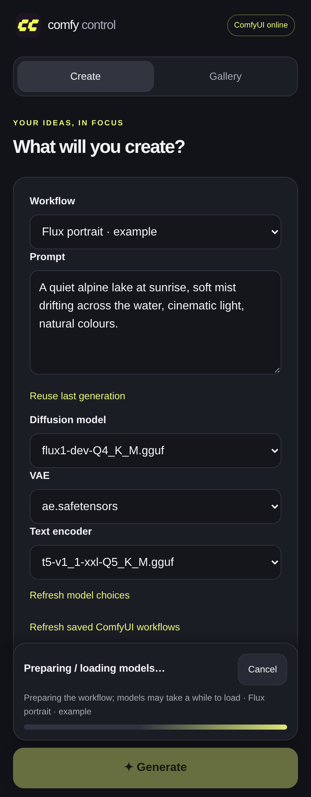
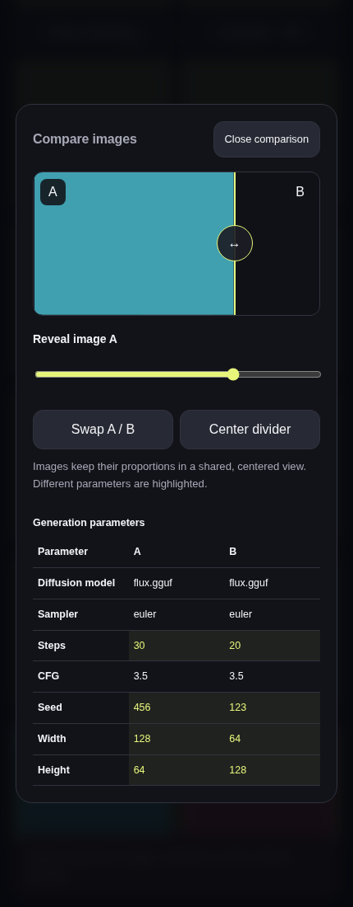

# Mobile WebUI

Included in **ComfyUI Control 1.0.0**. No separate service or mobile installation
is required. Keep the desktop app open while using it.

The [responsive interface](RESPONSIVE_WEBUI.md) uses the same address on
phones, large iPads and laptops. Wider windows show settings beside a pinned
preview/results column; narrow windows and Split View keep the compact layout.

## Run from source in an isolated environment

Close any running ComfyUI Control window, then:

```bash
git clone --single-branch --branch main https://github.com/jhakuzi/comfyui-control.git comfyui-control-mobile
cd comfyui-control-mobile
python3 -m venv .venv-test
.venv-test/bin/python -m pip install .
.venv-test/bin/comfyui-control
```

Use the usual distribution prerequisites in the [README](../README.md).
This test environment does not replace your RPM or desktop launcher. It reads
your existing launch settings; mobile preferences are stored separately.
Only one copy of the app can run at a time for the same user.

Alternatively, [download the app ZIP](https://github.com/jhakuzi/comfyui-control/raw/refs/heads/main/downloads/comfyui-control.zip)
and use `bash install.sh` for the usual per-user installation. That changes the
per-user launcher; use the isolated environment above if you want an easy
return to your stable RPM.

## Connect your iPhone


*Current UI at phone width using an example workflow; model inference is not shown.*

1. Open **Mobile WebUI** in the desktop window.
2. Enable the feature. It listens on `0.0.0.0` for IPv4 LAN/VPN access and
   automatically advertises the detected local address in the URL and QR code.
   **Use LAN / VPN** restores this automatic setup. You can still enter a
   particular interface IP, IPv6 address, or `127.0.0.1` for local-only access.
3. Choose a port (default **8189**). Password protection is **optional** and off
   by default. Check **Use a password** if wanted, then enter at least 10 characters.
4. Check **ComfyUI API URL**. It defaults to `http://127.0.0.1:8188`; change it
   if your launch flags use another port. ComfyUI itself can remain loopback-only.
5. Click **Apply**, wait for **Listening**, and scan the QR with the iPhone camera.
   Sign in only if you enabled a password. The QR contains only the URL.

**Open in browser** and **Copy URL** use the same address. The QR updates when
the advertised address or port changes; apply changes before connecting.
Existing advertised-address overrides are preserved. For a VPN hostname or
reverse proxy, close the app and set `advertised` in
`~/.config/comfyui-control/mobile/settings.json` (or under `$XDG_CONFIG_HOME`).
**Use LAN / VPN** clears this override and restores automatic address detection.
A full HTTP(S) origin can override the advertised URL for a reverse proxy,
for example `https://comfy.your-vpn-domain.example`. Its external port is
independent of the internal listener port. Path-prefix proxying is not supported.

If you use Fedora's firewall, allow the selected port in the appropriate LAN
or VPN zone yourself. Do not open a public router port. The app makes no firewall,
router, UPnP, or VPN configuration changes. Your phone must be able to route to
the advertised address, and any configured DNS name must resolve on the phone.

Earlier localhost-only default settings migrate to LAN access. Explicit custom
addresses and existing passwords are kept; after saving new settings, an
intentional localhost-only choice stays unchanged.

## Choose a workflow on the PC or from ComfyUI

In the desktop **Mobile WebUI** dialog, **Default workflow** automatically lists
JSON files in your selected installation's `user/default/workflows/`, including
subfolders. Reopening the picker refreshes the list. Select a file, wait for it
to import, then click **Apply**. Existing mobile presets are listed too.

Discovery works with ComfyUI offline. Importing node-editor files needs a running
ComfyUI for its node metadata; API-format files can be imported offline.
Alternatively, use these buttons:

- **Browse workflows saved in ComfyUI** reads the same server-side files used
  by ComfyUI's Workflows menu. ComfyUI must be running.
- **Choose workflow file from this computer** opens the local saved-workflow
  folder when available; API-format JSON also works with ComfyUI offline.
- **Use latest queued workflow from ComfyUI** copies an executable graph from
  its queue/history, including custom nodes, quantized models and LoRAs.

New phones automatically select the default; a phone's previous valid selection
and unsent edits take priority. One-time mapping adjustments can be done on the
PC with **Open in browser**. You do not need JSON files on the phone.

On the phone, the **Workflow** selector also includes **Saved in ComfyUI**.
Selecting one imports a mobile copy; **Refresh saved ComfyUI workflows** updates
that list. Re-selecting an unchanged saved workflow reuses its mobile mappings.
The source file is never overwritten. Unsaved changes in ComfyUI's browser
aren't available to the backend: save the workflow or queue it first. This sets
Mobile WebUI's default, not the node editor's browser-local startup tab.

### Saved-workflow compatibility

Imports prefer an exact matching executable snapshot from queue/history. When
none exists, ordinary node-editor JSON is converted using ComfyUI's input
metadata, preserving links and validating widget order/types. Muted nodes are
omitted; bypassed LoRAs and other nodes are routed through their single matching
typed input, including chains. Ambiguous bypasses, custom dynamic widgets,
frontend-only reroutes, and subgraphs may need an API export. An ambiguous import
is refused with instructions rather than guessing.
For those workflows, queue the saved version once in ComfyUI and reselect it,
or export API format. Uploading raw API JSON in **Advanced & workflows → Import
workflow** remains supported.

Required connections are checked on branches leading to output nodes, matching
ComfyUI. Unused decoder nodes with empty inputs are preserved without blocking
valid branches. If an active node is missing `samples` or another required input,
connect it in ComfyUI and save again, or import an API-format export. The importer
does not invent connections or overwrite the original file.

### Models and generation controls

Recognized literal inputs get controls automatically. The page shows separate
**Diffusion model**, **VAE**, and **Text encoder** selectors when those loaders
exist. Workflows using checkpoints or multiple text encoders keep their own
loaders. Choices come from ComfyUI, including custom/quantized loaders.

For **GGUF Loader**, **Unet Loader (GGUF)** and their Advanced versions, **Diffusion model** appears
above VAE and text encoder. Its dropdown uses the loader's registered GGUF
filenames, including files in `models/diffusion_models` and any configured model
paths. An existing Advanced mapping for that filename is shown here too, keeping
its saved key and role. Custom GGUF combos are recognized from `MODEL` output
metadata and `.gguf` choices; dtype and patch options stay separate.
Both `gguf_name` (gguf-pack) and `unet_name` (City96) are supported.

Older presets gain missing model controls when opened with ComfyUI online;
existing mapping keys, labels and roles are preserved. Custom loaders using
`model_name`, `model_path` or `model_file` are recognized when their metadata
declares a single `MODEL` output. Other input names can still be mapped explicitly.
Use **Refresh model choices** after starting ComfyUI or adding models. This
fetches fresh choices and adds missing loader controls without changing the
saved graph or replacing your current prompt/model edits. Choices remain specific
to the selected loader; the app does not swap node types or quantization formats.
Controls explicitly hidden in the mapping editor stay hidden on ordinary loads;
the refresh button can restore recognized model controls when wanted.
If a loader's filename comes from a connection rather than a literal value,
use the mapping editor to map the upstream filename input; connections are
never replaced with a guessed model name.

**Generation settings** contains sampler/scheduler, CFG (or guidance), steps,
seed and batch where present. Steps/CFG have sliders plus numeric inputs.
**Resolution** contains literal width/height or the calculator controls:
megapixels, aspect ratio, divisible by, custom ratio and custom aspect ratio.
Megapixels also has a slider. When width/height are connected to a calculator,
those links stay intact; editing its inputs changes the resulting resolution.

For custom names, review or change **Advanced & workflows → Map workflow inputs**:

| Role | Example use |
| --- | --- |
| Positive / negative prompt | A text encoder's literal text input. |
| Model / checkpoint; diffusion / VAE / text encoder | The corresponding loader filename. |
| LoRA model / strength / enabled | A filename, numeric strength, or boolean switch on your particular LoRA nodes. |
| Width / height / batch | Literal size and batch inputs on the appropriate image/latent nodes. |
| Sampler / scheduler / steps / CFG / seed | Literal sampling inputs, including separate sampler-selection nodes. |
| Resolution calculator | Megapixels, aspect ratio, alignment, custom ratio, custom aspect ratio. |
| Other advanced control | Another supported literal text, numeric, or boolean input. |

Save the mapping. Only mapped controls appear on the generation screen. No
node IDs or class names are built into the application. Choices and numeric
limits are read from ComfyUI's `/object_info`; custom loaders can provide their
own lists. If a custom widget doesn't expose its choices through that API,
its mapped filename is a text control, or you can leave its saved value alone.

Several controls can have the same role, allowing separate encoders or samplers.
Each literal input can be mapped once. Connection arrays, nested structures,
and opaque custom widget state cannot be edited by these controls and remain
unchanged. Prompt mapping follows positive/negative connections where available;
review unusual multi-encoder graphs in the mapping editor. Required inputs and missing nodes are checked before/while queueing;
ComfyUI's validation errors are returned to the page.

### LoRA groups

Multiple LoRA nodes and strengths are supported. Mappings from the same node
share a group by default; edit the group name in the mapping editor to group
separate model/CLIP strength inputs when appropriate.

A group with mapped strengths can be switched off by setting those strengths
to zero in the submission copy. The stored defaults are kept for re-enabling.
A mapped boolean enable input controls that node directly instead. Nodes whose
bypass state is encoded in graph structure or opaque custom data cannot safely
be toggled this way: leave them fixed in the original workflow or expose an
appropriate literal enable/strength input in ComfyUI first.

The source file is never overwritten. The imported graph is stored separately
and every generation uses a deep copy with only explicitly mapped values changed.
Changing mappings changes the preset revision; stale generation forms and reuse
requests are rejected until reloaded.

## Generate, view, and reuse

<a href="screenshots/mobile-loading-0.10.1.png"></a>
<a href="screenshots/mobile-generation-0.10.1.png"></a>

*Example workflow with simulated preparation and sampling events.*

Live queue status, sampling progress and a small preview stay anchored above
**Generate** while you scroll through Create or Gallery. Submission feedback is
immediate and the page does not jump. When generation finishes, **View result**
opens the image directly; the full results and reuse controls remain in Create.

An animated indicator shows **Preparing / loading models…**
before sampling begins, including a cold server's first model load. It stays
anchored above Generate. Step counts replace it when available; between sampling
stages it returns to a processing indicator. Loading has no invented percentage.

1. Start ComfyUI using the desktop app, then choose your mobile preset.
2. Enter the prompt. Expand LoRAs or generation settings if you want to adjust them.
3. Press **Generate**. Submissions use durable request IDs so a retry or lost
   response doesn't enqueue the same request again.
4. Watch queue position, node progress, and previews where ComfyUI supplies them.
   A job may have no preview or progress count; completion is still detected.
5. Tap the completed image to view it, or open **Gallery**. Use **Save image**;
   in Safari you can also touch and hold an image to save it to Photos.

Testing **0.11.2.dev1** doubles the positive prompt box's default height. Tap
**Expand** beside its label for more writing space, then **Collapse** to return.
Your size choice is remembered per workflow and prompt field across refreshes;
resizing keeps the text intact and does not submit a generation.

Use **Reuse last generation**, **Same seed**, or **New variation** to prepare
the next form, then press **Generate**. Fixed 64-bit seeds retain their exact
value. Randomization affects mapped seeds only. A preset without a seed mapping
keeps its original behaviour.

**Randomize seed for each generation** is on by default.
Uncheck it to unlock the Seed field, then clear or replace its value manually.
Older drafts adopt this default once without losing prompts or stored seed values.
Uncheck it to keep the seed fixed; your subsequent choice is remembered.
**Same seed** explicitly switches to a fixed
seed; **New variation** enables randomization. If a fixed seed and every other
input stay unchanged, ComfyUI may return its cached image immediately and log
`Prompt executed in 0.00 seconds`. Change the seed or enable randomization for
a fresh variation; the app does not disable ComfyUI's cache or change your workflow.

Queue cancellation removes only the selected prompt. Running-job cancellation
uses ComfyUI's job-specific cancellation API. Older ComfyUI versions without
that endpoint show an error; the app never falls back to global interruption.
Cancel such a running job in ComfyUI itself.

Job state is stored by the desktop app, so reloading or reconnecting restores it.
The interface shows an uncertain submission rather than blindly retrying if
ComfyUI's response was lost. Check the queue before explicitly starting a new
request in that situation. After a ComfyUI restart, history may be gone; local
output images remain browsable.

### Screen locking, app switching, and reconnecting

When Safari becomes active again (including returning from its back/forward
cache), the page reopens its live connection automatically. It shows the desktop
backend's cached sampling progress immediately, then reconciles the ComfyUI
queue and history. Images that completed while the phone was disconnected
appear automatically. A temporary VPN outage retries with a bounded backoff;
there is no recurring queue polling while connected. No generation is restarted
or submitted by this recovery path.

The desktop keeps its existing ComfyUI WebSocket open independently of the
phone. The phone uses Server-Sent Events. Sampling counters resume when ComfyUI
provides them; if the desktop itself lost its upstream connection, it resumes
live counters on the next ComfyUI progress event. Queue/history APIs cannot
invent sampling counters that ComfyUI does not expose.

The selected workflow, unsent prompt/settings, unsaved input mappings, expanded
sections, selected tab, and scroll position are saved in browser storage.
Refreshing restores these edits rather than replacing them with the last
submitted prompt. Request IDs survive connection failures to prevent duplicate
submissions. Generation controls stay disabled while recovery is in progress.

Each browser profile has a persistent HttpOnly client-identity cookie. By default its
jobs, progress, previews, cancellation, and reuse metadata are isolated from
other profiles. Tabs in the same profile share that identity; presets and the
output-image gallery remain shared. Clearing site cookies or using a new
private-browsing session creates a new identity. Clearing browser storage loses
local drafts/UI state. Sign-out explicitly clears local drafts. Authentication
still expires after 12 hours, or on a mobile-server restart; signing in again
with the same identity restores its jobs.

Jobs from the earlier `0.9.0.dev1` testing build had no browser ownership and
are not assigned to a new browser automatically. Their output files remain
browsable in the gallery. This avoids exposing one client's old jobs to another.

Gallery entries reference existing output files or ComfyUI's image API; image
files are not copied into a second library. Recent history and a bounded scan
of the selected output folder populate the gallery. Mobile-created images have
saved prompt/settings metadata for reuse. Other images may have no mobile
metadata. Temporary previews and deleted files can become unavailable.

### Reuse image settings across your devices

In the desktop app, open **Mobile WebUI**, enable **Share image prompts and
settings between browsers**, then click **Apply** and refresh the phone page.
The saved option also applies to SSH startup. It is off by default; enabling it
lets any browser allowed into this WebUI inspect and reuse image prompts/settings.
Use it for your trusted LAN/VPN devices. Password protection remains optional.

The gallery uses the saved generation record where available, otherwise the
API workflow embedded in the original PNG. Choose **Reuse settings** for the
recorded seed or **New variation** to enable randomization, then tap Generate.
Original image files stay unchanged. Missing PNG metadata is explained in the
viewer. Live jobs, progress/previews, cancellation and prompt history still
belong to the browser that started them. Another browser's PNG download continues
to omit raw embedded workflow text; inspected settings are shared through the API.

Turning sharing off prevents further cross-browser image-detail/reuse access.
Drafts or shared workflow presets already copied through reuse remain saved;
this option does not erase settings a device has already received.

**Reuse settings** and **New variation** also
read API workflow metadata from local PNGs saved directly by ComfyUI, including
the configured NFS output. Compatible saved mappings are reused; otherwise a
separate image workflow preset is created. Original PNGs, graphs and source
workflows are unchanged. Reuse fills the form without submitting a generation;
variation enables seed randomization. Missing metadata or an unmapped seed is
explained inside the image viewer. Another browser's mobile image settings remain
unavailable unless image sharing is enabled. Wide-screen gallery thumbnails use 768px or 1280px previews
instead of stretching the phone's 384px previews.

### Live statistics

The pinned progress card shows only **s/it**, **used VRAM** and **GPU utilization**.
It shares the desktop sampler, including AMD sysfs/ROCm and NVIDIA detection;
opening more phone tabs does not start additional GPU readers. Samples are
requested about once a second while a connected phone has an active job, even
if the desktop monitor is collapsed or minimized. Closing/suspending the page
releases that request. Normal desktop monitoring can still keep the sampler busy.

Sampling speed uses the current job's actual progress-event intervals, excluding
model loading. Missing sensors, ambiguous/parallel progress and connection gaps
show `--`. Hardware values refer to this PC: if the configured ComfyUI API URL
points to another machine, GPU metrics stay unavailable. Reconnection restores
cached job progress without submitting another generation.

### Prompt history and favorites

Tap **History & favorites** near the prompt. Search Recent or Favorites, tap a
prompt to restore its positive and negative fields, or use the star/Delete actions.
Reuse changes prompts only; it keeps the current models, seed and other settings
and never presses Generate. Multiple text inputs are restored in mapping order;
if their counts differ, choose a matching workflow first.

History is recorded only after ComfyUI accepts a submission, including acceptance
recovered after a lost response. Repeated identical prompt pairs update one entry
and keep its favorite flag. Deleting an entry is not undone by reconnecting or
reopening an old job. **Clear history** confirms removal of all entries, including
favorites, without deleting images or presets.

History belongs to the existing browser-identity cookie and survives app restarts.
Tabs sharing that identity share history; a different browser profile gets its
own. The private files live under `mobile/prompts/` in the app configuration folder.
Each identity retains up to 200 entries/100 favorites and 4 MiB; old non-favorites
are removed first. Very large prompt sets (over 100,000 characters) or storage
errors do not stop generation and show a history warning instead.

### Image details

Open a gallery image and expand **Details**. Prompts and common generation values
appear first; models/LoRAs and additional parameters are collapsible. **Copy prompt**
copies the positive text, with a selection-based fallback for ordinary LAN HTTP.
If the browser blocks copying, the prompt text remains selectable.

Mobile images use their original saved submission values, even after a preset is
edited. Existing local ComfyUI PNGs can supply embedded API-graph metadata. The
inspector uses existing mapping/detection rules; it does not guess ambiguous
custom prompt inputs or require standard node classes. It reports the actual
image dimensions separately from workflow resolution settings. No missing value
is invented. Non-PNGs without saved mobile-job data can show dimensions only.

Additional details include mapped inputs and safe numeric/boolean or enumerated
custom-node values, not raw graphs, arbitrary PNG text, or credential-like inputs.
Unknown connections and the original graph are untouched.

The output gallery is still shared, but by default another mobile identity cannot
inspect your generation details or reuse settings. The optional sharing setting
above permits those image actions across devices. A small `mobile/image-owners.json`
ledger retains that boundary after old job records are pruned. When another
identity opens/downloads an owned image, the server sends pixels without its
embedded prompt text; the original file is not modified. Thumbnails also omit
embedded text. Images created directly in ComfyUI, with no mobile owner, retain
their shared embedded metadata. Keep the ownership ledger when preserving jobs.

### Compare two images



*Comparison with test images and example generation metadata.*

In **Gallery**, tap **Select two images**, select A and B, then **Compare**.
Selection and Compare stay pinned below the phone's safe area while scrolling;
**Done selecting** leaves your pair selected for comparison.
Drag the divider or use the range slider; keyboard arrows, Home and End work
too. **Swap A / B** reverses the images and **Center** restores the 50% split.
Images retain their proportions in the same viewport. Closing keeps the gallery
position and selection. Full images download only when comparison opens; a
loading count appears until both are downloaded and ready. On a weak connection,
**Retry loading images** keeps the successfully loaded image and retries the other.

Version 0.11.1 keeps **Close** pinned while scrolling and positions dialogs inside
the phone's safe areas, clear of the status bar, camera cutout and home indicator.
Reopening comparison starts at the top without discarding the cached pair.

While Gallery is visible, it checks for output changes every five seconds.
Opening Gallery, returning to the app, or tapping **Refresh** checks immediately.
Deleted local output files disappear from the gallery and comparison selection;
replacing a file refreshes its thumbnail and cached comparison. Other thumbnails
stay in place. An open viewer/comparison closes if its image was deleted.
Network errors keep the previous gallery until connection returns.

Local synchronization uses the output folder configured in desktop Settings.
For a remote ComfyUI API, references are removed only when ComfyUI confirms an
image is missing; this app cannot scan that remote machine's filesystem.

The selected pair stays in the phone tab's memory, so reopening or swapping it
works without further image downloads, even offline. Only that pair is kept;
deselecting an image releases it. Refreshing/closing the page or signing out
clears the cache. This works over ordinary LAN HTTP without a service worker.

The table highlights differing models, samplers, steps, CFG, seeds, resolution
and LoRA values when available. Mobile jobs use their saved mapped settings;
local PNGs can supply recognized settings from ComfyUI's embedded prompt metadata.
Missing metadata shows an unavailable message. Prompts and arbitrary custom-node
values are excluded. Another browser's image parameters require the optional
image-settings sharing preference; its live job record is never returned.
Original files are unchanged; no duplicate files are stored on the PC.

## Home-screen / PWA use

The site has a manifest, icons, standalone mode, and iPhone home-screen metadata.
Use Safari's **Share → Add to Home Screen** where supported.

HTTP over a LAN or VPN IP is generally **not a secure context**. The ordinary
website remains functional, but service workers and full installation features
depend on browser policy. Service workers are registered only in a secure
context, such as HTTPS through your own trusted reverse proxy, or localhost.
Only public shell assets are cached. Prompts, jobs, API responses, and generated
images are never put into the service-worker cache.

## Security and lifecycle

- The feature is disabled by default. Enabling it uses all IPv4 interfaces and
  an automatically detected advertised address unless you choose a custom interface.
- Password protection is optional on every interface. When enabled, passwords
  are salted/hashed and sessions use HttpOnly, SameSite cookies. Restarting the
  mobile server expires sign-ins; the browser identity and its jobs remain.
- Host and Origin checks protect against DNS rebinding and cross-site mutation.
  The advertised hostname must match how you access the site.
- There are no endpoints accepting arbitrary file paths, proxy URLs, shell
  commands, launch settings, credentials, or environment variables.
- Import only workflows and custom nodes you trust: execution has the same
  capabilities as running that workflow in ComfyUI. Unmapped literal values
  are not sent to the browser by the mapping-candidate endpoint.
- Listening on every interface may expose the port on networks beyond your VPN.
  Select an interface and appropriate firewall zone for your situation.
- Plain HTTP is not encrypted; use the VPN or HTTPS for untrusted networks.
  HTTPS is provided by your own proxy, not by a built-in certificate installer.
- Opening/closing the phone page never starts, stops, or restarts ComfyUI.
- Closing the desktop app stops the mobile listener cleanly. Its existing
  ComfyUI shutdown confirmation still applies to owned running processes.

Files live under the app's config directory (`~/.config/comfyui-control/mobile`
by default): `settings.json`, `presets/`, and `jobs.json`. The original launch
configuration remains in `config.json`. Treat this directory as private: it
contains your workflow text and prompts, as well as a password hash.

## Architecture and testing

See [the architecture and verification notes](MOBILE_ARCHITECTURE.md) for module
boundaries, protocol tests, and the limits of what has actually been verified.
Physical iPhone Safari, your VPN/LAN routing, HTTPS proxying, and your particular
GPU/quantized-model/LoRA workflows still require testing on your own installation.
