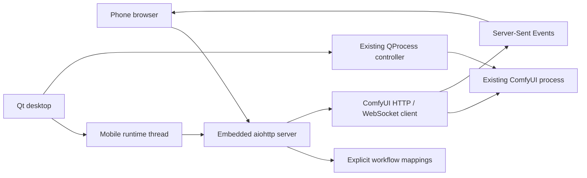

# Mobile WebUI architecture and verification

## Existing application review

The existing app is Python/PySide6 Qt Widgets. `app.py` owns the main window and
dialogs; `Controller` owns asynchronous `QProcess` sessions, process groups,
start/stop/restart, output decoding, and Git/Comfy CLI updates. `config.py`
handles installation launch settings and output/model folder overrides.
`setup.py`, `launch_script.py`, `script_flags.py`, and the flag/update widgets
handle installation and launch configuration. There was no HTTP server,
ComfyUI API client, WebSocket client, saved generation workflow, or model/LoRA
configuration service to reuse.

## Integration



`mobile/runtime.py` is a Qt signal bridge around one background asyncio thread.
It owns the HTTP listener, client session, socket reconnect loop, and clean
shutdown. Qt stays responsive; there is no separate executable or service.
Controller process ownership is unchanged. Its configuration/output-folder and
state changes are forwarded to the mobile service; the mobile service never
calls process start/stop/restart.

`mobile/settings.py` reuses the app's config location and adds typed mobile
preferences plus atomic, private JSON storage. Keeping this separate prevents
existing launch dialogs from dropping mobile preferences when they save.
`mobile_widgets.py` provides settings, workflow import, connection status,
browser/copy actions, and a local SVG QR rasterized by Qt for display.

`mobile/workflows.py` validates API graphs, immutable import, literal-only
mappings, metadata-derived choices, typed/ranged modifications, LoRA groups,
and exact seed handling. No workflow-specific node IDs/classes are hardcoded.

`mobile/client.py` is the new fixed-origin ComfyUI client. `mobile/service.py`
handles job journaling/idempotency, WebSocket events, bounded snapshots, queued
cancellation, target-specific running cancellation, image references, gallery,
and reconnect resynchronization. Outputs remain in ComfyUI storage. Jobs/images
are scoped to the configured API endpoint/output folder.

`mobile/server.py` owns route validation, sessions, host/origin checks, path
confinement, SSE, memory-cached gallery thumbnails, and public assets. Thumbnail
encoding runs off the event loop and creates no duplicate files. The frontend in `mobile/web/` has no build
step, CDN, external font, or JavaScript framework. `aiohttp` and `qrcode` are
the only new runtime dependencies; QR generation does not require Pillow.

## Compatibility boundaries

- ComfyUI's node-editor JSON needs API export first.
- Opaque nested widget data and connection rewiring are preserved, not exposed.
- Complex LoRA bypass and nonliteral generation inputs need a suitable input in
  the source workflow; the mobile interface does not rebuild nodes.
- A custom loader's own API combo choices drive model selection. Filesystem
  model paths are not guessed or exposed through a directory browser.
- Running cancellation requires `/api/jobs/{prompt_id}/cancel`; old global
  interruption endpoints are deliberately not used.
- Standard preview frames and metadata-bearing preview frames are handled when
  supplied by ComfyUI. Queue/history resync happens on events/reconnection,
  rather than continuous HTTP polling. SSE heartbeats carry no generation work.
- Gallery scans are requested by the user, bounded to 10,000 directory entries
  and 200 displayed images; unavailable or symlinked local images are refused.
- Browser jobs are shared by this app instance. This is a private-network,
  password-protected single-owner interface, not a public multi-tenant service.

## Verification performed

- Existing desktop/config/controller tests and new mobile tests run together.
- Tests exercise immutable arbitrary custom-node graphs, quantized-loader model
  choices from metadata, multiple LoRA strength mappings, fixed 64-bit seeds,
  authentication, CSRF/Host rejection, path and symlink confinement, durable
  request IDs, queue/progress/preview/completion, restore/reconnect, gallery,
  cancellation, port conflicts, automatic listener startup, Qt responsiveness,
  launch-setting independence, and clean shutdown.
- Chromium on Linux exercised the actual frontend at widths 320, 375, 390, 430,
  768, and 1200 pixels with no horizontal overflow or JavaScript errors. Login,
  submit, preview, completion, reload/restore, download, and settings reuse were
  exercised against an explicitly simulated ComfyUI backend, not model inference.
- The desktop QR was decoded with ZXing, including a changed advertised port.
- An actual ComfyUI 0.40.0 / CPU PyTorch 2.14.1 workflow ran
  `EmptyImage → ImageScale → SaveImage`, produced two 128×128 PNGs, and served
  them through the mobile gallery/image endpoints. A repeated request used the
  same prompt ID. The saved graph remained unchanged. This is an image/queue/
  upscaling smoke test, **not diffusion or LoRA inference**.

Not verified: physical iPhone/iOS Safari, real LAN/VPN routing, HTTPS reverse
proxy installation, or real GPU/quantized-model/LoRA inference. Non-loopback
browser access is unavailable in this cloud environment. WebKit was downloaded
but could not run because required system libraries are unavailable; no Safari
compatibility claim is made from Chromium emulation.

## Run the checks

```bash
.venv-test/bin/python -m pip install pytest
QT_QPA_PLATFORM=offscreen .venv-test/bin/python -m pytest
```

The protocol tests use only loopback servers and do not require a model or GPU.
The separate manual browser checks need Playwright/Chromium. SSE progress
snapshots omit prompt/control values; full job details are fetched on new jobs
and image changes rather than on every progress event. Packaging must
include `mobile/web/*` in the wheel/app ZIP and `aiohttp`/`qrcode` in Fedora
dependencies. The Python development version is `0.9.0.dev1`; RPM uses
`0.9.0-0.1.dev1`, so a later stable `0.9.0-1` sorts above it.

Optional, reproducible manual checks from the repository root:

```bash
.venv-test/bin/python -m pip install playwright
.venv-test/bin/python -m playwright install chromium
.venv-test/bin/python tests/manual/mobile_browser.py
```

The browser script runs an explicitly simulated backend and creates a temporary
results directory with screenshots. Linux Chromium system libraries must be
available. It does not access your ComfyUI installation or personal settings.

To exercise an already-running ComfyUI server with a model-free image workflow:

```bash
.venv-test/bin/python tests/manual/mobile_comfy_smoke.py --comfy-url http://127.0.0.1:8188
```

That explicitly queues two small smoke-test images in the selected ComfyUI and
leaves them in its output folder. It does not restart ComfyUI or cancel other
work. Optionally pass `--comfy-output /your/ComfyUI/output` to exercise the local
folder path as well. The [example API graph](../examples/mobile-smoke-api.json)
can also be imported from the interface; it tests image creation/upscaling and
saving without a diffusion model, and has no prompt/model/LoRA controls.

This branch is preliminary: push no release tag and publish nothing to the
stable COPR project while testing.
