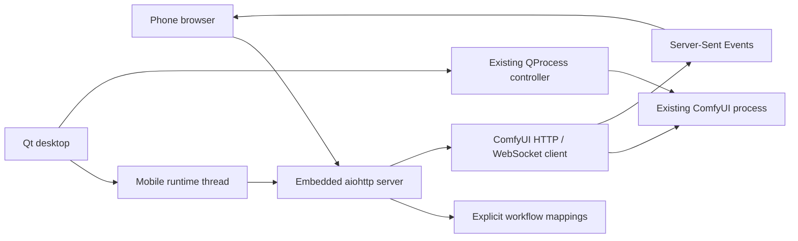

# Mobile WebUI architecture and verification

## 0.11.2.dev2 desktop tray lifecycle

The main window owns a native `QSystemTrayIcon` using the existing application
icon. Its Show window/activation actions restore the existing window; Quit
reuses the owned-process and mobile-runtime shutdown path. The close dialog
offers tray/quit/cancel only when Qt reports an available tray host. Hiding
leaves shutdown/recovery state untouched and retains the enabled mobile server.
A lightweight timer runs only while hidden to restore access if the host vanishes.

The application explicitly quits after shutdown completes, including from a
hidden window; Qt's last-visible-window behaviour alone is insufficient here.
Tests cover all close choices, tray restoration/host loss, cancellation, updates,
a real owned process and child alongside the embedded HTTP listener, and the
actual entry point's event-loop exit. Offscreen tests simulate tray availability;
all 214 automated checks passed locally and on Fedora 44. Native Plasma/Wayland
icon placement remains a user check.

## 0.11.2.dev1 prompt editor

The existing mapped positive-text control now starts at 288px rather than 144px.
A native button in its label row toggles a taller responsive height, with
`aria-expanded`/`aria-controls` and no form submission or input replacement.
Expansion choices use the existing browser UI state, keyed by preset and field;
prompt values, workflow mappings and generation/session services are unchanged.
Negative prompts and workflow-import textareas retain their previous sizing.

Chromium and Linux WebKit checks passed for touch/keyboard toggles, preservation
of unsent multiline text and selection, refresh persistence, manual-resize reset,
and phone/tablet/landscape widths. All 202 automated checks passed locally.
Existing history, generation progress,
recovery, metadata, GGUF and two-LoRA browser checks passed as part of that run.

Release **0.11.1** includes the comparison safe-area and gallery synchronization
fixes below. The user confirmed the iPhone testing build works before release.

## 0.11.1.dev2 gallery controls and file reconciliation

The existing sticky comparison toolbar now reserves the same safe-area insets
as the dialogs. Selection, Done selecting and Compare stay reachable in a long
gallery without changing the layout or comparison cache design.

Gallery requests share a locked, short-lived filesystem scan cache in the
existing service. Worker-thread scans validate old references as well as finding
new output; restoring job associations cannot resurrect deleted local files.
History, workflow mappings, ownership and generation records remain intact.
File modification timestamps version image URLs so replacement files invalidate
thumbnails and selected-pair blobs. Remote/temp references survive absent local
files; only confirmed ComfyUI 404/410 responses mark them unavailable.

The browser checks a small gallery revision response every five seconds while
Gallery is visible, pauses on tab/background/auth changes, and forces a refresh
on opening/recovery. ComfyUI has no file-deletion event to reuse. Reconciliation
retains unchanged thumbnail DOM nodes, prunes deleted selections and closes
viewers of deleted images. Failed network requests retain the previous gallery.
There are no additional filesystem watchers, image copies, GPU samplers or
generation/reconnect services.

All 202 automated checks passed locally and on Fedora 44/Python 3.14. Browser
checks passed in Chromium and Linux WebKit for sticky controls with simulated
iPhone insets, real fixture deletion/replacement, selection/blob eviction,
open-viewer reconciliation, retained thumbnail nodes, failed-network handling,
and paused/foreground synchronization. Existing comparison-cache, metadata,
history, custom GGUF/two-LoRA and generation/session-recovery checks passed too.
Browser generation uses a ComfyUI protocol test double; physical iPhone and
real LAN/VPN checks remain user validation.

## 0.11.1.dev1 comparison layout fix

Shared dialog bounds reserve CSS `safe-area-inset-*` space and track the dynamic
viewport height. The comparison header now uses the same sticky positioning as
the image/history viewers; its Close button cannot shrink below its touch target.
New comparison opens reset dialog scroll without discarding the selected pair.
No viewport event listeners, additional requests, or generation changes are added.

The regression check reproduces the old failure in Linux WebKit with simulated
iPhone insets: Close started at y=33 inside a 59px top safe area. Chromium and
WebKit now check reachable Close at the top and after scrolling, portrait and
landscape insets, viewport-height changes, larger text, and reopening. These
are controlled browser checks, not a physical iPhone/home-screen test.

## 0.11.0.dev1 additions

The new statistics share `MonitorPanel`'s single Qt hardware sampler through
`MobileRuntime`; SSE subscriber/job activity requests samples without a second
GPU worker. Per-job sampling intervals use `GenerationPerformance` and the
existing ComfyUI socket. Values and previews stay attached to their owner's job.
The mobile progress card keeps its existing fixed position beside Generate.

`mobile/prompt_history.py` uses the existing atomic/private JSON writer and
browser-identity hash, separate from the bounded job journal. The service records
accepted submissions and recovered acknowledgements once. History requests are
serialized and run in the existing background I/O executor. No history polling,
gallery dependency, workflow migration or extra ComfyUI extension is needed.

`image_metadata.py` now shares PNG parsing between the existing comparison
allowlist and the lazy Details endpoint. Explicit mapping roles take priority
over detection; safe unmapped scalar parameters are supplemental. Submission
snapshots remain stable if a preset changes. Image ownership survives job
pruning in a separate ledger. Foreign-client image responses remove embedded
text in memory, so downloading a PNG cannot bypass Details ownership; disk files
are untouched. Unknown/unowned ComfyUI output remains shared as before.

The small `prompt_history.js` and `image_details.js` components extend the current
HTML dialogs and viewer. They use the existing API error handling, draft saving
and SSE recovery rather than parallel generation/session logic.

The 174 automated checks passed locally and with Fedora 44's system Qt during
the development RPM build. The RPM/ZIP installation and embedded-server smoke
checks passed. `mobile_extras_browser.py` passed in Chromium and Linux WebKit
with phone/tablet/landscape viewports: pinned metrics, prompt search/favorites/
reuse, persistent state after an app restart, loss/recovery of browser connectivity,
independent clients, exact seeds, PNG/mobile details and copying were exercised
with a protocol test double. Existing Chromium generation/recovery, comparison,
preparation/seed and custom-GGUF mapping checks also ran. These are not physical
iPhone Safari, LAN/VPN or real GPU inference tests.

Against a real CPU ComfyUI server, the updated smoke check generated/upscaled
images through the queue, loaded mobile submission details and metadata from a
separate direct ComfyUI submission, preserved graphs/files, and checked request
deduplication. Real AMD/NVIDIA sensor readings remain a hardware check.

Follow-up testing passed all 184 checks locally and on Fedora 44/Python 3.14.8.
Saved editor imports now omit muted nodes and resolve unambiguous typed bypass
chains, including separate MODEL/CLIP paths, without interpreting disabled-node
widgets or changing the source. Ambiguous/wildcard routing remains refused.
Real CPU ComfyUI imported a saved workflow with a bypassed ImageScale and an
unused decoder, then generated two images through the forwarded canvas link.
This checks bypass execution without claiming real LoRA/model inference.
Chromium and Linux WebKit also checked the single visible Negative prompt
heading and bordered refresh buttons directly below History & favorites at
phone/tablet widths; the existing recovery, gallery and GGUF checks passed.

Comparison downloads and decodes both images before showing the divider. Only
the selected pair's blob URLs and comparison metadata are held in tab memory;
deselection revokes URLs and authentication loss clears them. A failed download
can be retried while retaining the completed side. Neither private HTTP caching
nor service-worker image storage is enabled. Chromium and Linux WebKit checks
exercise a delayed second image, offline reopen/swap, interrupted-download retry,
URL eviction, authentication clearing, and unchanged original files. History and
generation-reuse controls now use the same bordered button style as refresh.

## Original desktop review (before Mobile WebUI)

The existing app is Python/PySide6 Qt Widgets. `app.py` owns the main window and
dialogs; `Controller` owns asynchronous `QProcess` sessions, process groups,
start/stop/restart, output decoding, and Git/Comfy CLI updates. `config.py`
handles installation launch settings and output/model folder overrides.
`setup.py`, `launch_script.py`, `script_flags.py`, and the flag/update widgets
handle installation and launch configuration. There was no HTTP server,
ComfyUI API client, WebSocket client, saved generation workflow, or model/LoRA
configuration service to reuse.

## Integration



`mobile/runtime.py` is a Qt signal bridge around one background asyncio thread.
It owns the HTTP listener, client session, socket reconnect loop, and clean
shutdown. Qt stays responsive; there is no separate executable or service.
Controller process ownership is unchanged. Its configuration/output-folder and
state changes are forwarded to the mobile service; the mobile service never
calls process start/stop/restart.

`mobile/settings.py` reuses the app's config location and adds typed mobile
preferences plus atomic, private JSON storage. Keeping this separate prevents
existing launch dialogs from dropping mobile preferences when they save.
`mobile_widgets.py` provides settings, workflow import, connection status,
browser/copy actions, and a local SVG QR rasterized by Qt for display.

`mobile/workflows.py` validates API graphs, immutable import, literal-only
mappings, metadata-derived choices, typed/ranged modifications, LoRA groups,
and exact seed handling. Recognized input names get suggested mappings; the
explicit editor remains available for custom names. No node IDs/classes are hardcoded.
`mobile/workflow_sources.py` handles the saved catalog, exact snapshot matching,
and validated editor-to-API conversion. The desktop performs network imports in
an on-demand Qt thread-pool task so settings remain responsive.

`mobile/client.py` is the new fixed-origin ComfyUI client. `mobile/service.py`
handles job journaling/idempotency, WebSocket events, bounded snapshots, queued
cancellation, target-specific running cancellation, image references, gallery,
and reconnect resynchronization. Outputs remain in ComfyUI storage. Jobs/images
are scoped to the configured API endpoint/output folder.

`mobile/server.py` owns route validation, sessions, host/origin checks, path
confinement, SSE, memory-cached gallery thumbnails, and public assets. Thumbnail
encoding runs off the event loop and creates no duplicate files. The frontend in `mobile/web/` has no build
step, CDN, external font, or JavaScript framework. `aiohttp` and `qrcode` are
the only new runtime dependencies; QR generation does not require Pillow.

## Compatibility boundaries

- Saved workflows are listed/read only beneath ComfyUI's `workflows/` userdata
  directory. Imports prefer exact API history snapshots, then metadata conversion.
  Unknown widget serialization, frontend-only nodes, subgraphs or bypass modes
  require a matching snapshot or API export; inputs/connections aren't guessed.
- Opaque nested widget data and connection rewiring are preserved, not exposed.
- Complex LoRA bypass and nonliteral generation inputs need a suitable input in
  the source workflow; the mobile interface does not rebuild nodes.
- A custom loader's own API combo choices drive model selection. Filesystem
  model paths are not guessed or exposed through a directory browser.
- Running cancellation requires `/api/jobs/{prompt_id}/cancel`; old global
  interruption endpoints are deliberately not used.
- Standard preview frames and metadata-bearing preview frames are handled when
  supplied by ComfyUI. Queue/history resync happens on events/reconnection,
  rather than continuous HTTP polling. SSE heartbeats carry no generation work.
- Gallery scans are requested by the user, bounded to 10,000 directory entries
  and 200 displayed images; unavailable or symlinked local images are refused.
- Browser jobs are scoped to a persistent HttpOnly identity cookie; only its
  hash is journaled as job ownership. Each state/SSE response filters jobs and
  previews by owner, and mutation endpoints enforce ownership. Presets and
  output files remain shared. This separates browser sessions within a private
  single-owner app; it does not introduce multiple user accounts.

## Verification performed

- Existing desktop/config/controller tests and new mobile tests run together.
- The fixed generation panel was checked during delayed submission, queueing,
  sampling, previews, page scrolling, Gallery navigation, foreground recovery,
  and completion. Chromium verified visible controls at 320–1200 pixel widths
  and in 844×390 landscape, with no forced submission scroll or horizontal
  overflow. The result shortcut opens the existing full-size viewer.
- Real ComfyUI 0.40.0 with City96's ComfyUI-GGUF plugin
  (`6ea2651e7df66d7585f6ffee804b20e92fb38b8a`) served normal and Advanced loader
  metadata. Chromium selected between two placeholder filenames discovered in
  `models/diffusion_models`, retained the choice across reload, and verified
  the rendered API value. This exercised real plugin discovery, not GGUF
  inference: the files were empty fixtures and no prompt was queued.
- GGUF regression tests cover the standard/Advanced schemas, custom filename
  input names, an existing Advanced mapping displayed in the main model group,
  valid choice enforcement, original graph preservation, and submitted values.
- The `gguf-pack` implementation titled **GGUF Loader** was inspected at
  `e1b3982333503f7a7c7b040b573f9620d791cb10`: its `LoaderGGUF` and Advanced
  variant use `gguf_name`, rather than City96's `unet_name`. Both contracts are
  covered by tests; the complete gguf-pack runtime was not installed or executed.
- Regression coverage verifies older presets acquire missing model controls
  without changing existing mappings or graph connections, and that explicit
  mapping edits remain respected. Model refresh bypasses cached node metadata.
  Chromium exercised a custom loader's `model_name` selector, verified the
  selected value in the submitted API graph, and preserved an older browser's
  unsent draft through the upgrade and fresh-model discovery.
- The desktop picker discovers nested local workflow files without a running
  ComfyUI, imports API JSON offline, refreshes newly saved files, and reuses an
  unchanged preset. Tests reject symlink escapes and check that source JSON is
  untouched. Required-input checks retain valid saved links, accept unused
  decoders, and reject missing connections on active branches with a clear error.
- Real ComfyUI also generated two model-free images from a saved workflow with
  an unused, unconnected VAEDecode node 43 retained in the imported graph.
- Tests cover automatic LAN defaults and migration, optional LAN authentication,
  PC default-workflow selection, background desktop imports, saved catalog path
  confinement, three model selectors, sampler/CFG/steps sliders, and calculator
  edits with width/height links preserved. Chromium exercised those controls at
  320–1200 pixel widths against representative custom-node metadata.
- Real ComfyUI 0.40.0 also imported a temporary saved node-editor workflow through
  its userdata catalog, converted it using actual metadata, generated/upscaled
  two images, and retained the original saved JSON. The temporary workflow was
  removed afterward. The actual Flux calculator plugin/quantized inference was
  not installed or executed; its controls were tested with representative metadata.
- Tests exercise immutable arbitrary custom-node graphs, quantized-loader model
  choices from metadata, multiple LoRA strength mappings, fixed 64-bit seeds,
  authentication, CSRF/Host rejection, path and symlink confinement, durable
  request IDs, queue/progress/preview/completion, restore/reconnect, gallery,
  cancellation, port conflicts, automatic listener startup, Qt responsiveness,
  launch-setting independence, and clean shutdown.
- Chromium on Linux exercised the actual frontend at widths 320, 375, 390, 430,
  768, and 1200 pixels with no horizontal overflow or JavaScript errors. Login,
  submit, preview, completion, reload/restore, download, and settings reuse were
  exercised against an explicitly simulated ComfyUI backend, not model inference.
- The desktop QR was decoded with ZXing, including a changed advertised port.
- Chromium also exercised simulated pagehide/pageshow, offline/online recovery
  during sampling, restored live counters before completion, preserved unsent
  draft/UI state across reload, completion while disconnected, and two separate
  browser profiles. Protocol tests cover owner-filtered SSE/state/previews,
  cancellation/retry ownership, durable identity/job restoration, lost enqueue
  responses, and recovery from history beyond the recent-history window.
- An actual ComfyUI 0.40.0 / CPU PyTorch 2.14.1 workflow ran
  `EmptyImage → ImageScale → SaveImage`, produced two 128×128 PNGs, and served
  them through the mobile gallery/image endpoints. A repeated request used the
  same prompt ID. The saved graph remained unchanged. This is an image/queue/
  upscaling smoke test, **not diffusion or LoRA inference**.

Not verified: physical iPhone/iOS Safari, real LAN/VPN routing, HTTPS reverse
proxy installation, or real GPU/quantized-model/LoRA inference. Non-loopback
browser access is unavailable in this cloud environment. WebKit was downloaded
but could not run because required system libraries are unavailable; no Safari
compatibility claim is made from Chromium emulation.

## Run the checks

```bash
.venv-test/bin/python -m pip install pytest
QT_QPA_PLATFORM=offscreen .venv-test/bin/python -m pytest
```

The protocol tests use only loopback servers and do not require a model or GPU.
The separate manual browser checks need Playwright/Chromium. SSE progress
snapshots omit prompt/control values; full job details are fetched on new jobs
and image changes rather than on every progress event. Packaging must
include `mobile/web/*` in the wheel/app ZIP and `aiohttp`/`qrcode` in Fedora
dependencies. The stable Python version is `0.9.0`; RPM uses `0.9.0-1`, which upgrades
the earlier `0.9.0-0.x.dev*` testing packages.

Optional, reproducible manual checks from the repository root:

```bash
.venv-test/bin/python -m pip install playwright
.venv-test/bin/python -m playwright install chromium
.venv-test/bin/python tests/manual/mobile_browser.py
```

The browser script runs an explicitly simulated backend and creates a temporary
results directory with screenshots. Linux Chromium system libraries must be
available. It does not access your ComfyUI installation or personal settings.

To exercise an already-running ComfyUI server with a model-free image workflow:

```bash
.venv-test/bin/python tests/manual/mobile_comfy_smoke.py --comfy-url http://127.0.0.1:8188
```

That explicitly queues two small smoke-test images in the selected ComfyUI and
leaves them in its output folder. It does not restart ComfyUI or cancel other
work. Optionally pass `--comfy-output /your/ComfyUI/output` to exercise the local
folder path as well. The [example API graph](../examples/mobile-smoke-api.json)
can also be imported from the interface; it tests image creation/upscaling and
saving without a diffusion model, and has no prompt/model/LoRA controls.

For future development builds, use a `.devN` Python version and RPM Release
`0.x.devN`. Validate without publishing to COPR; see the [release guide](../packaging/README.md).

Saved catalog/editor conversion smoke check against an already running ComfyUI:

```bash
.venv-test/bin/python tests/manual/mobile_saved_comfy_smoke.py --comfy-url http://127.0.0.1:8188
```

This creates then removes one uniquely named temporary saved workflow and leaves
its two small generated images in output. The optional browser control check is
`tests/manual/mobile_workflows_browser.py` (requires pytest and Playwright).
Add `--unused-decoder` to verify that an unused VAEDecode node with unconnected
inputs survives conversion and does not block the real ComfyUI output branch.

The desktop default picker scans `user/default/workflows/` in its Qt thread pool;
it reads only the selected JSON file, importing an API graph offline or using the
existing metadata converter for editor JSON. No filesystem endpoint is added.
Conversion validates required connections upstream of metadata-declared output
nodes; if output metadata is absent, it keeps strict validation of all nodes.

Run `tests/manual/mobile_workflows_browser.py --gguf` for the protocol browser
check with an existing Advanced mapping. Against an already running server with
ComfyUI-GGUF and at least two registered model filenames, run:

```bash
.venv-test/bin/python tests/manual/mobile_gguf_metadata_smoke.py --comfy-url http://127.0.0.1:8188
.venv-test/bin/python tests/manual/mobile_gguf_metadata_smoke.py --comfy-url http://127.0.0.1:8188 --loader UnetLoaderGGUFAdvanced
```

This check requires Playwright/Chromium and only reads metadata, edits a temporary
mobile preset, and inspects the rendered graph. It never queues a prompt, loads a
GGUF file, or writes into your ComfyUI installation.
