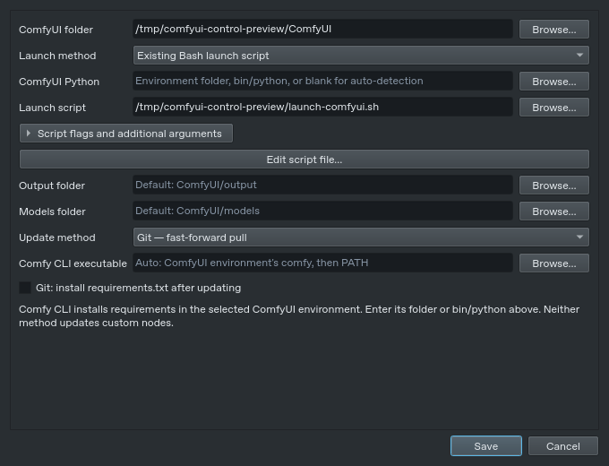
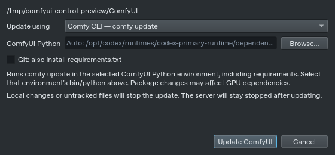

# Usage guide

[Back to the README](../README.md)

A small Python + Qt 6 desktop app for ComfyUI on Linux, built with KDE Plasma in mind.

**Start / Stop · Restart · Git or Comfy CLI updates · Launch flag checkboxes · Folder shortcuts**


*Fedora RPM with a dark Qt theme and a CPU ComfyUI server.*

## Install

[Download the app ZIP](https://github.com/jhakuzi/comfyui-control/raw/refs/heads/main/downloads/comfyui-control.zip), extract it, and open a terminal in the extracted folder.

The app ZIP excludes screenshots and tests. GitHub's **Code → Download ZIP** on the main branch includes the full development repository.

Install prerequisites for your distribution:

**Fedora**

```bash
sudo dnf install python3 python3-pip git
```

**Debian / Ubuntu**

```bash
sudo apt update
sudo apt install python3 python3-pip python3-venv git
```

**Arch Linux**

```bash
sudo pacman -S --needed python python-pip git
```

Then run the installer as your normal user, **without sudo**:

```bash
bash install.sh
```

Open **ComfyUI Control** from your application menu, or run `~/.local/bin/comfyui-control`.

The app uses its own Python/Qt environment. Your ComfyUI environment stays separate. Existing Python 3 installations, including 3.14, can be used; GPU drivers and models are configured separately.

[Fedora RPM / COPR instructions](../packaging/README.md) · [COPR project](https://copr.fedorainfracloud.org/coprs/jhakuzi/comfyui-control/)

## First launch

| Option | Action |
| --- | --- |
| **Choose existing installation** | Select the ComfyUI folder containing `main.py`. |
| **Install with Comfy CLI** | Choose a new folder, Python, and GPU/CPU option. Open the setup terminal, then click **Use this installation** after success. |


Use **Set up ComfyUI** to reopen setup or **Change folder** to switch installations. Switching folders resets launch settings.

<details>
<summary>New installation setup</summary>

Setup creates a companion Python environment beside ComfyUI and runs `pip install comfy-cli` followed by `comfy install`. It uses Konsole, GNOME Terminal, or xterm; commands can also be copied into your own terminal. Canceling the dialog leaves the setup terminal running.


</details>

## SSH startup (testing)

`comfyui-control --start-server --start-webui` runs in the foreground without
a desktop login. Ctrl+C stops both components and their owned processes.
See the [SSH guide and testing install](SSH.md).

## Launch settings

The main heading shows **ComfyUI - version** when the selected installation
provides version metadata. It refreshes after switching installations or finishing
an update. The window title separately shows ComfyUI Control's version.

Open **Settings** while stopped. Flags start collapsed: expand **Edit script flags**, **Script flags and additional arguments**, or **Edit launch flags**, depending on your launch method.
The larger window fits to the available screen area. Application style and
**Close button action** remain editable while ComfyUI runs. Close choices are
remembered by default; use **Ask me** to show the choice dialog again.

| Setting | Use |
| --- | --- |
| **ComfyUI Python** | Enter an environment folder or its `bin/python`, or leave blank for auto-detection. |
| **Launch method** | Run `main.py` directly or select an existing Bash script. |
| **Launch flags** | Search checkboxes, set **Reserve VRAM**, or enter values such as `--port 8188` under **Other arguments**. |
| **Output folder** | Set ComfyUI's save destination and the app/mobile gallery folder on the next start/restart. A locally mounted NAS folder can be selected here. |
| **Models folder** | Change the folder shortcut if your models are stored elsewhere. |



**Create launch script** saves a new executable `.sh` with your environment, selected flags, and HIP allocator setting. Existing scripts are never overwritten. App-created scripts follow your current checkbox selections; hardcoded flags in custom scripts need manual editing. Custom scripts should forward `"$@"` and use `exec` to launch Python.

Selecting an existing script reads its literal flags and VRAM value into the controls. Locked options come from the file; app-added arguments remain editable and are saved separately. Scripts are never executed for inspection. Variables or complex shell logic may prevent reliable detection.

When an output folder or integrated NFS output is configured, **Save** automatically
adapts a simple existing script to receive the app's output argument. It preserves
your Python/environment and flags, keeps an exact backup beside the script, and
logs the changes. Simple Fish-style `; or exit 1` guards in a Bash script are also
corrected. Ambiguous or unwritable scripts show the specific reason and an editor
option; NAS connection settings can still be saved for mount setup. See
[network output](NFS_OUTPUT.md) for details.

[Detected options from an existing script](../script-flags-preview.png)

[Flag selection when creating a script](../flags-preview.png)

The output pane is read-only. The app controls servers it starts; stop any separately running ComfyUI first.

## Updates

### ComfyUI

Click **Update** to choose either method and review the ComfyUI Python environment. The drop-down beside the button sets your saved default.



| Method | Behavior |
| --- | --- |
| **Git** | `git pull --ff-only`; optional requirements installation, off by default. |
| **Comfy CLI** | `comfy update` for the selected folder and environment, including requirements. Choose this if you already use Comfy CLI. |

For CLI updates, use **Choose environment** to select your `comfy-env` or Conda folder. You can also enter its `bin/python` path. The app detects `comfy` there or on PATH; an explicit executable can be set in launch configuration.

Changes to tracked files stop updates. Untracked files such as `.env` and `gpucore.*` can remain; Git reports actual file conflicts. A running server restarts only after success. Installing requirements can change GPU packages. Custom nodes and this controller app are updated separately.

### This app

For an RPM installation, close the app and run `sudo dnf upgrade --refresh comfyui-control`.

Close the app, extract the latest app ZIP, and rerun `bash install.sh`. Settings and your ComfyUI installation are kept.

From a Git checkout, run:

```bash
git pull --ff-only
bash install.sh
```

## Troubleshooting

The app includes a **System & generation** panel and optional
crash recovery in **Settings**. See [monitoring, recovery and
image comparison](FEATURES.md) for controls and measurement limits.

| Problem | Check |
| --- | --- |
| ComfyUI exits immediately | Read the log and verify your Python or launch script works in a terminal. |
| Folder unavailable | Mount the drive or use **Change folder**. |
| CLI or setup terminal missing | Select/install `comfy-cli`; for setup, install Konsole, GNOME Terminal, or xterm. |
| Script editor missing | Install Kate or KWrite, or edit the script manually. |
| Bash reports `or: command not found` | With output routing configured, saving Settings fixes simple `; or exit 1` guards automatically and keeps a backup. Otherwise replace them with Bash `\|\| exit 1`. |
| CLI cannot save configuration | Ensure `~/.config/comfy-cli` is writable. |

For an **xcb plugin error on Fedora**:

```bash
sudo dnf install libxcb xcb-util-cursor xcb-util-wm xcb-util-keysyms libxkbcommon-x11
```

Settings: `~/.config/comfyui-control/config.json` (or your XDG config folder).


## Uninstall

For a default per-user install, remove `~/.local/share/comfyui-control`, `~/.local/share/applications/comfyui-control.desktop`, and `~/.local/bin/comfyui-control`. Use your XDG data folder if customized. Settings can be kept for reinstalling; ComfyUI and models are unaffected.

For an RPM install: `sudo dnf remove comfyui-control`.


## Install bundled workflows

The native desktop **Install bundled workflows** button beside Settings opens an
optional installer for VeryComfy, SeedVR Upscaler and Qwen Edit. It is also offered
after selecting an existing installation or completing fresh setup. Review the
selected files and destination `<ComfyUI>/user/default/workflows`, then choose
**Install selected**. Existing files are skipped unless replacement is explicitly
selected and confirmed. Results show installed, skipped and failed files.

Open the regular ComfyUI WebUI at least once, load each installed workflow and use
ComfyUI Manager to install missing custom nodes; restart ComfyUI when prompted.
Models and referenced input images must also be available. The installer copies
JSONs only. See [bundled workflow details](BUNDLED_WORKFLOWS.md).

## Batch Count in Desktop and Phone generation settings

Batch Count queues separate workflow runs. For example, **4** queues four prompts
with mapped workflow batch inputs set to **1**, rather than one four-image batch.
The count is from 1 to 20, within the app's existing limit of 20 unfinished jobs.
Other workflow settings and connections are preserved.

Random seed mode draws a fresh seed for each run. Fixed seed mode keeps the exact
chosen seed for every run; ComfyUI may reuse cached results for identical inputs.
The status shows **Run 2 of 4**, follows the current run and shows the latest result.
All saved images are available in Gallery. Unsent edits and the count survive reload.

Cancel stops the remaining batch runs. Pending prompts are removed first; running
work is interrupted only when ComfyUI supports safe per-job cancellation. Other
clients' work is left alone. A rejected or uncertain submission stops further
runs and reports the issue. Reconnect/retry checks the existing UUID journal and
never blindly queues the batch again.
